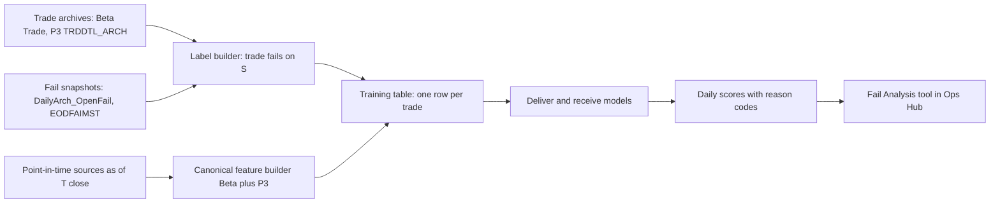

# 00 — Master Plan: Fail Prediction Model

- **Status:** Approved 2026-10-14
- **Official documentation:** [`../failanalysispredictivemodel.md`](../failanalysispredictivemodel.md)
- **Phase plans:** [`01`](01-phase0-data-access.md) to [`07`](07-phase5-fail-persistence.md)

## Purpose

Predict settlement fails before they happen. The model scores every pending trade at the close of the business day before it settles. Operations can then act overnight and early on settle date: borrow, recall a loan, chase affirmation, or call the counterparty.

The model sits beside the Fail Analysis tool described in the PRD (`../../fail-analysis-tracking-prd.docx.pdf`) and the EDD (`../../FailAnalysisToolDevPlan.docx.pdf`). Those documents cover the operational workbench for fails that already exist. This model covers the ones that haven't happened yet.

## What changes from the initial proposal

**Reframed target**
- v1 predicts whether each pending trade (settlement obligation) will fail on its contractual settle date S.
- It is scored at trade-date close, T = S-1 under T+1.
- Label: the trade appears on the open-fail snapshot for S, with Age 1.
- The original "still open on the T+1 snapshot" framing at CUSIP grain becomes the phase-5 fail-persistence model.

**Negatives come from the trade archives, not the fail tables.** The fail tables only contain trades that already failed.
- Beta: `BetaAccessArchive.dbo.Trade` (plus the live `BetaAccess.dbo.Trade` for recent days) joins to `BetaDailyArchive.dbo.DailyArch_OpenFailReceiveDeliverInfo`. The keys are `ControlNumber`, `TradeDate`, `AccountNumber`, `SecurityNumber` and `CUSIP`, the same as in `GetBetaFailAnalysisData_Report`.
- P3: `Phase3DB.dbo.TRDDTL_ARCH` joins to `Phase3DB.dbo.EODFAIMST` on `TRADE_FULL_DATE`, `ACCT_NBR`, `CCURRENCY`, `ACCT_TYPE`, `MARKET`, `TRAN_NBR` and `FIRM_NBR`.

**Outcome attributes are never features of the trade being scored.** This covers `DKCount`, `DTCReasonCode`, `FailWho`, `FailConditionCode`, `FAIL_REASON` and `StockLoanRate`. They are only allowed as lagged, rolled-up counterparty or account history, using settle dates before S.

**Leaky or overwritten sources get replaced**
- Counterparty type, account name and price in the fail-analysis procedures come from current-state tables (`BetaAccess.Account`, `BetaAccess.Security`, `NMARED_REPL`, `SECBAS_REPL`). Use trade-record attributes and the `DailyArch_*` and `EOD*` archives instead.
- `CNS_FirmConsecutiveFailsTbl` is truncated on every run. Rebuild it from `Phase3DB.CNS_8199_S1_Data` and `NSCC.CNS_S1_Data`.
- `StockLoanBorrow.OpenReceiveDeliver` and `BorrowForNeeds.OpenFailToDeliver` are derived from the open-fails table. Use them only after their job timing is verified.
- `SmartLoanSLAvail` is keyed on `FileDate`. Its `TradeDate` is the next business day.
- `FailAnalysisComments` must be filtered by `CreatedOn`.

**Corrections to the proposal**
- `ClosingNetPosition` is a column, not a table.
- `DailyArch_SecurityPrice.LastClosePrice` is never populated. Use `SecurityCloseHistory`, and derive ADV from `CloseVolume`.
- Bid/ask exists in `DailyArch_Security`, `SecurityPriceHistorical` and `MOTS.QuotesHistory`.
- The HTB/ETB lists live in `LocateSecurity` and `Intranet`, which are not mirrored. Proxies are listed in the documentation.
- The 204 numerics (`ThresholdIndex`, `SOD_CNS_FailDayQty`) are stored as varchar.

**Added features**
- `DailyArch_SegregationAnalysisInfo`: box available vs. required, start-of-day deficit, loan and borrow quantities.
- `DailyArch_Security`: DTC chill flags and CNS eligibility.
- `DailyArch_IDConfirms`: affirmation status.
- `SecurityExtensionHistory.ThresholdInd`.
- Execution time and as-of trades.
- Calendar effects.

**Targets, not features.** Fail charges and close-out proxies are phase-5 severity targets.

## v1 design



**Scoring time**
- About 22:30 ET on D = S-1. That is after the 21:00 ET affirmation cutoff and the 22:00 P3 snapshot.
- Optional re-score at 06:30 ET on S.

**Population.** It matches the fail-analysis procedures:
- Beta excludes `AccountType` 8 and `SecurityTypeCode` 'P'.
- P3 excludes `ACCT_TYPE` 2 and 3, and `SEC_TYPE` 5 and 6.
- Cancelled and corrected trades are dropped.

**Models**
- Two models: deliver (the priority) and receive.
- Each is pooled across Beta and P3 with a `book` feature, on one canonical schema.
- Benchmarks: a rule baseline and logistic regression.
- Primary model: LightGBM, with isotonic calibration and SHAP reason codes.

**Validation**
- Rolling-origin splits with a purge gap, plus an out-of-time holdout.
- Metrics: PR-AUC, precision and recall at daily top-K, dollar-weighted recall, calibration.
- Results are sliced by book, direction, product and counterparty type.

**Training window**
- Labels start at the T+1 cutover on 2024-05-28.
- Extracts start about one year earlier (2023-05-01), so 250-business-day look-backs are warm.

## Data access

The WSI DB Wrapper only runs allowlisted procedures (`POST /wsi-db-wrapper/stored-procs/execute`), at 100 calls a minute with a 300-second timeout.

Requests to WSI:
- Date-parameterized extract procedures registered in `OperationsPortalDB.dbo.WSIDBWrapperSPList`, or a read-only replica for the backfill.
- Access to `LocateSecurity`, `Intranet` and `ReplicateDB_Archive`.

## Project folder

```
Model/
  failanalysispredictivemodel.md      official living model documentation
  plans/                              00 to 07, written before any build work
  requests/                           data-access requests sent to WSI
  sql/extract/                        proposed WSI extract procedures
  sql/profiling/                      read-only profiling queries
  sql/labels/                         server-side reference label and reconciliation queries
  sql/scores/                         score table DDL
  src/failmodel/                      Python package (canonical mapping, labels, features, models, scoring)
  tests/                              unit and leakage tests (synthetic data)
  notebooks/                          exploratory work
  data/  artifacts/                   local extracts and model files, git-ignored
```

## Phase index

| # | Plan file | Phase | Status |
|---|---|---|---|
| 01 | [01-phase0-data-access.md](01-phase0-data-access.md) | Data-access request and extract spec | See file |
| 02 | [02-phase0-source-profiling.md](02-phase0-source-profiling.md) | Source profiling | See file |
| 03 | [03-phase1-labels.md](03-phase1-labels.md) | Trade universe and labels | See file |
| 04 | [04-phase2-features.md](04-phase2-features.md) | Point-in-time features and leakage tests | See file |
| 05 | [05-phase3-modeling.md](05-phase3-modeling.md) | Modeling, validation, calibration | See file |
| 06 | [06-phase4-shadow-scoring.md](06-phase4-shadow-scoring.md) | Shadow scoring and monitoring | See file |
| 07 | [07-phase5-fail-persistence.md](07-phase5-fail-persistence.md) | Fail persistence and close-out risk | See file |

## Working rules

- Phases run in file order. A phase starts only after the previous phase's exit criteria are met, or its open blockers are recorded in the documentation.
- Each phase bumps the documentation version, adds a changelog entry that links its plan file, and records results and decisions.
- No trade-level data, account numbers or model binaries are committed. `data/` and `artifacts/` are git-ignored.
