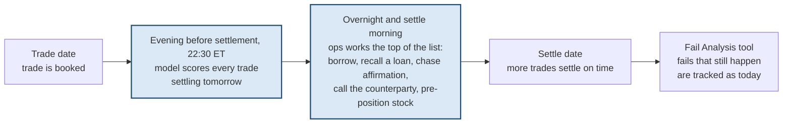
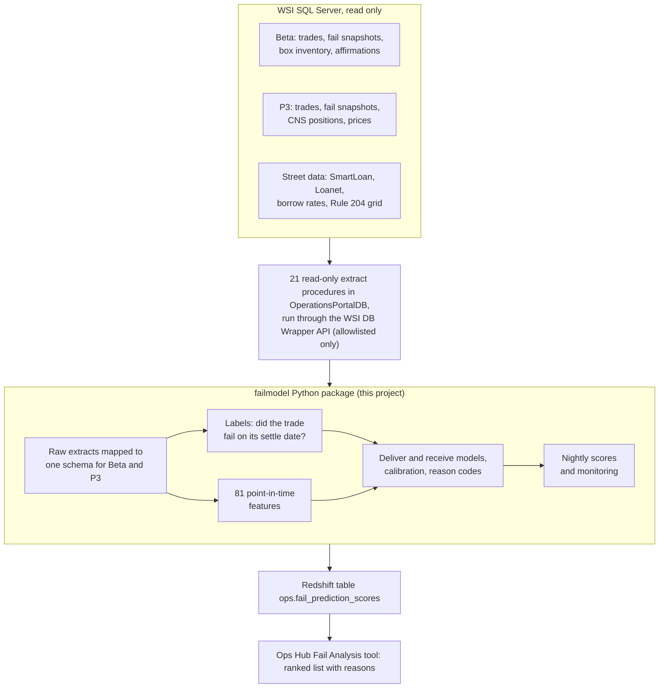
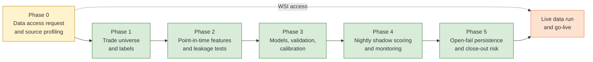
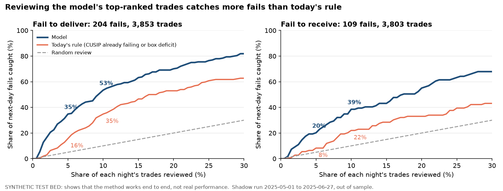
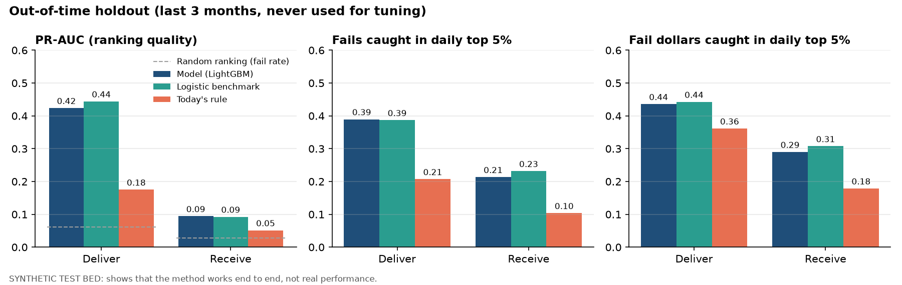
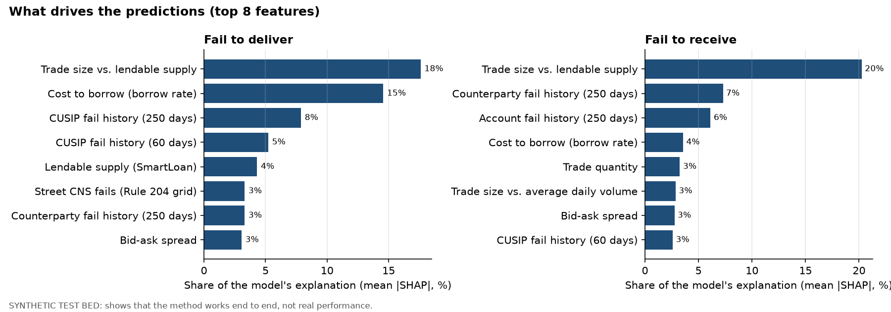
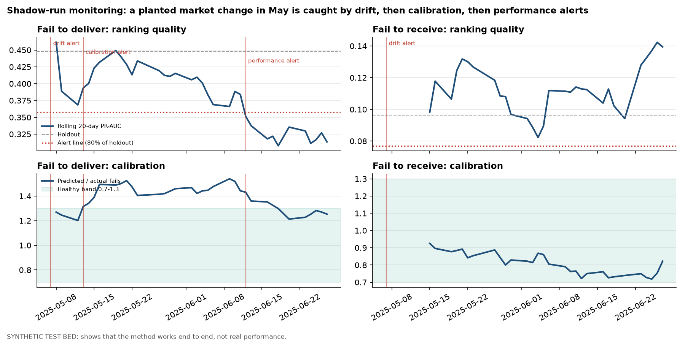
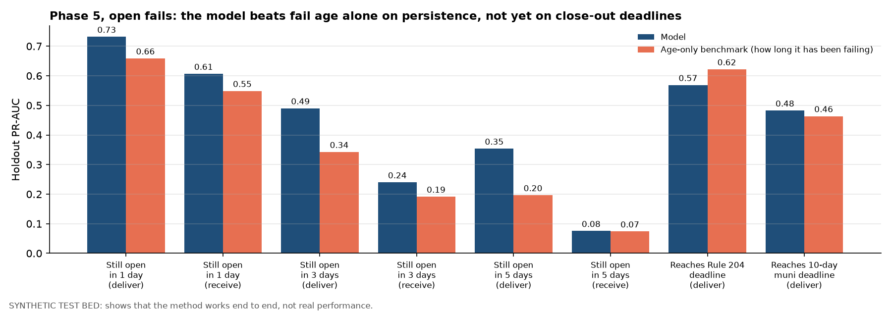
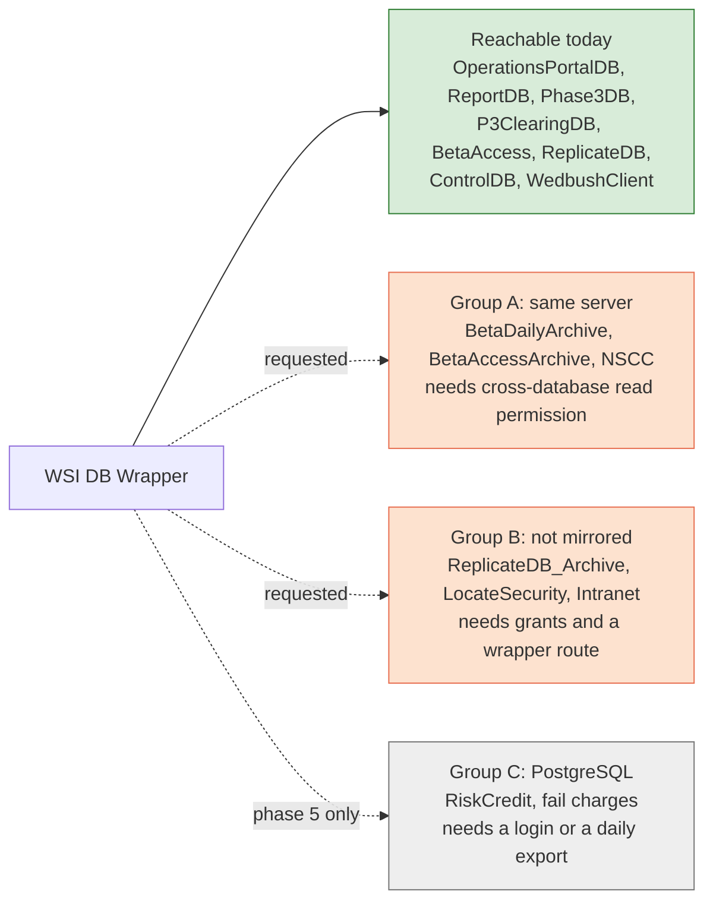
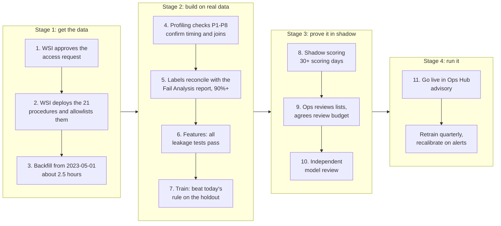

# Fail Prediction Model: Project Overview and Handover

| | |
|---|---|
| **What this is** | A plain-language overview of the Fail Prediction Model project: the problem, what has been built, where it stands, what is blocking it, and how someone else would take it over |
| **Owner** | Data & Decision Science, Pranay Koneni |
| **Business owner** | WTS Operations (Settlements / Fail Analysis) |
| **Status** | All build phases are coded and tested end to end on a synthetic test bed. Real-data runs are waiting on WSI data access |
| **Last updated** | 2026-10-15 |
| **Technical reference** | [`failanalysispredictivemodel.md`](failanalysispredictivemodel.md), the official model documentation (v0.8.1). This overview summarises it and does not replace it |

**How to read this.** Sections 1 to 7 explain the project to a manager or stakeholder (about 15 minutes). Sections 8 to 11 are for whoever runs or takes over the project. Section 12 is a glossary.

---

## 1. Summary

**What.** An advisory model that runs every evening and ranks the trades settling the next business day by their chance of failing. Each trade comes with the top three reasons, so Operations can act overnight and on the morning of settlement, before the fail happens. A second model ranks fails that are already open by how likely they are to stay open or reach a close-out deadline.

**Why.** The Fail Analysis tool shows fails after they have happened. By then, fail charges, Reg SHO close-out exposure and buy-in risk are already running.

**Where it stands.**
- Every build phase is coded, documented and covered by 51 automated tests: data extracts, labels, features, models, nightly scoring, monitoring and the open-fail model.
- All of it runs end to end on a **synthetic test bed**. That is generated data in the exact WSI table layouts, because the project cannot read real WSI data yet.

**What the synthetic results show.** Reviewing the top 5% of each night's deliver trades would catch about **35% of next-day fails**, against **16% for today's rule** (CUSIP already failing, or box deficit). These numbers show the method works. **They are not real performance.** That is known only once real data flows.

**What is blocking it.** Data access through the WSI DB Wrapper. The request is written and ready to send: [`requests/wsi-data-access-request.md`](requests/wsi-data-access-request.md).

**What would help most from a manager:**
1. Sponsor the WSI data-access request. It is the critical path.
2. Help get two answers from Operations and the WTS data team: how many trades ops can review each night, and who runs the nightly job.

---

## 2. The business problem

A settlement fail costs money and creates risk well before anyone resolves it:
- NSCC CNS fail charges;
- Reg SHO Rule 204 close-out obligations (S+1 for short sales, S+3 for long sales);
- the firm's 10-business-day close-out limit for municipal fails;
- buy-in risk, capital charges and reputational cost.

**Today** the Fail Analysis report (Ops Portal, and the new Ops Hub tool) lists fails from their first day (Age 1). Triage is reactive. The best early warnings available are simple rules: the CUSIP is already failing, or the firm's box is short.

**With the model** the work moves to the evening before settlement:



Under T+1 the trade date and the evening before settlement are usually the same day. Scoring at 22:30 ET falls after the DTCC 21:00 ET affirmation cutoff and after the 22:00 ET P3 end-of-day fail snapshot, so the model sees the day's final state.

---

## 3. What the project delivers

### 3.1 The new-fail model (v1, the main deliverable)

| | |
|---|---|
| Question it answers | "Will this trade fail on its settle date?" |
| What it scores | Every Beta and P3 trade (customer and street side) due to settle the next business day. The population is the same one the Fail Analysis report covers |
| When | Nightly, at about 22:30 ET on the business day before settlement |
| Output | For each trade: a calibrated fail probability, a rank within its book and direction, and three plain-language reasons |
| Models | Two: fail to deliver (the priority) and fail to receive. Each covers both books |
| Where users see it | A Redshift score table (`ops.fail_prediction_scores`) read by the Ops Hub Fail Analysis tool |

**What a nightly list looks like.** This is an example from the synthetic shadow run: the top 5 deliver trades scored on 2025-06-02, a day from the middle of the run.

| Rank | Book | Product | Counterparty | Notional | Fail probability | Reason 1 | Reason 2 | Failed? |
|---|---|---|---|---|---|---|---|---|
| 1 | Beta | CORP | Customer | $409,422 | 33% | Trade quantity / SmartLoan total available: 62.6 | Volume-weighted average borrow rate: 2.7 | Yes |
| 2 | Beta | CORP | Customer | $170,560 | 32% | Trade quantity / SmartLoan total available: 58.3 | CUSIP fail rate, last 250 business days: 0.492 | Yes |
| 3 | Beta | CORP | Customer | $379,559 | 30% | Trade quantity / SmartLoan total available: 129 | CUSIP fail rate, last 250 business days: 0.492 | No |
| 4 | Beta | CORP | Customer | $286,636 | 26% | Trade quantity / SmartLoan total available: 43.8 | CUSIP fail rate, last 250 business days: 0.338 | No |
| 5 | Beta | CORP | Customer | $341,301 | 26% | Trade quantity / SmartLoan total available: 51.9 | CUSIP fail rate, last 250 business days: 0.338 | No |

That day 90 deliver trades were scored and 3 failed; 2 of the 3 were in the top 5. The data is synthetic, so the trades are not real, and the reason text is shortened. In the synthetic data one driver (trade size against lendable supply) dominates, which is why most reasons repeat. Real data will give a more varied list.

### 3.2 The open-fail model (phase 5, a follow-on)

For a fail that is already open, it predicts:
- whether the fail will still be open after 1, 3 and 5 business days;
- whether it will reach the Rule 204 close-out deadline (deliver-side equities) unresolved;
- whether it will reach the 10-business-day municipal close-out deadline unresolved.

It is built and tested. A third target, fail-charge severity (which fails cost the most), needs one more data source, PostgreSQL `RiskCredit` (section 7).

### 3.3 What it is not

- **It is advisory only.** It does not trigger buy-ins, close-outs, regulatory reports or client contact. People decide; the model ranks.
- **Not yet for Broadridge-booked trades.** The Broadridge feed has no fail flag yet, so the model cannot learn from it (section 9).
- **It does not cover non-trade fails**, such as transfers and stock-loan returns.

---

## 4. How it works

### 4.1 Data flow



**How a trade is labelled.** A trade counts as failed if it appears on that book's open-fail snapshot for its settle date (Age 1). The fail tables only contain trades that already failed, so the trades that settled cleanly come from the trade archives. This is the definition the Fail Analysis report uses, so the labels can be reconciled against it.

### 4.2 What the model looks at

| Signal family | Examples | Why it matters |
|---|---|---|
| Borrow and lendable supply | SmartLoan availability, Loanet rebates, borrow rates | Hard-to-borrow stock is the classic cause of fails to deliver |
| Firm inventory (Beta) | Box available against required, start-of-day deficit | No stock in the box means nothing to deliver |
| Fail pressure | Open fails in the CUSIP and book, CNS positions, Rule 204 grid | Fails cluster: one fail often causes the next |
| History | Fail rates by CUSIP, counterparty and account over 20, 60 and 250 days | Some names and counterparties fail repeatedly |
| Security and market | Price, spread, volume, Reg SHO threshold list, DTC chills, CNS eligibility | Illiquid or restricted securities settle less reliably |
| Trade | Size against supply and volume, notional, DVP, as-of trades, execution time, product | Large, late or unusual trades fail more |
| Affirmation (Beta institutional) | Confirm matched or affirmed | Unaffirmed DVP trades often fail |
| Calendar | Month and quarter end, day after a holiday, settlement volume | Busy days strain operations |

### 4.3 How the model is kept honest

The most common way prediction models fail in production is **leakage**: during training they quietly use information that would not exist at scoring time. They look excellent in testing and then disappoint. The project guards against this in four ways:
1. **Point-in-time data only.** Every input comes from a dated archive and is read as it was at 22:30 ET the evening before settlement. Tables that are overwritten daily are not used.
2. **Outcome fields are banned.** Fields that describe a fail after it happens, such as DK count, fail reason and fail condition, are never inputs for the trade being scored.
3. **Automated leakage tests** run on every build. The key one rebuilds everything with all future data removed or scrambled, and checks that no feature value changes. Deliberately broken versions are included to prove the tests catch problems; they caught one real bug during development.
4. **Fair testing.** Results come from the most recent 3 months of data. The model never sees those months during training or tuning, and must beat simple benchmarks there.

### 4.4 The modelling choices

- **The main model is LightGBM**, a gradient-boosted tree model that is standard for tabular risk scoring.
- **It must beat two benchmarks:** today's rule (CUSIP already failing, or box deficit) and a logistic regression. If the simpler logistic model is just as good on real data, it can be the v1 model.
- **Probabilities are calibrated.** "30%" should mean that about 3 in 10 such trades fail, so scores can be compared across days.
- **There are separate deliver and receive models,** because the causes differ: inventory and borrow for deliver, counterparty behaviour for receive.
- **Beta and P3 are pooled** into each model with a book indicator. This gives more history, and one schema makes the later Broadridge onboarding easier.

---

## 5. Where the project stands



Green means built and tested on synthetic data. Yellow means built and waiting on WSI. Orange means not started, because it is blocked.

| Phase | What was built | Status |
|---|---|---|
| 0. Data access and profiling | The WSI access request; 21 extract procedures and the allowlist script; the wrapper client; 8 profiling checks that confirm data timing and join rules | Request ready to send. Profiling runs as soon as data lands |
| 1. Labels | Trade universe for Beta and P3, fail labels, and reconciliation against the Fail Analysis report's Age-1 counts | Built and tested |
| 2. Features | 81 point-in-time features in 7 families, with the automated leakage tests | Built and tested |
| 3. Models | Benchmarks, LightGBM, rolling validation, calibration, reason codes and a versioned model bundle | Built and tested |
| 4. Shadow scoring | Nightly scoring, data-completeness checks, drift and performance monitoring, alerts, go-live checks, Redshift score table design | Built and tested; a 40-day simulated shadow run was completed |
| 5. Open-fail model | Fail tracking across days, persistence and close-out labels, models against an age-only benchmark | Built and tested; the severity target waits on data access |

**Why build everything before having data?** Because the access request takes time, and building against a faithful copy of the WSI layouts means that once data arrives, only the data changes. Every step has already been run end to end, every edge case seen in the WSI table definitions is covered by tests, and the remaining work is running, checking and tuning on real data.

---

## 6. Results so far (synthetic test bed)

> **Read this first.** Every number in this section comes from synthetic data. The test bed copies the WSI table layouts and plants realistic patterns, such as hard-to-borrow names failing more and bad counterparties repeating. A model that finds those patterns proves the pipeline is correct. **It says nothing about how well the model will do on real trades.** That is measured in phase 3 and in the shadow period once data access is in place.

### 6.1 Fails caught at a fixed review budget

This is the chart that matters most to Operations. The question is: if ops reviews the top X% of each night's trades, what share of the next day's fails were on that list? The data is the simulated shadow run (2025-05-01 to 2025-06-27). The model was scored on days it had never seen, exactly as it would run in production.



| Nightly review budget | Deliver: model | Deliver: today's rule | Receive: model | Receive: today's rule |
|---|---|---|---|---|
| Top 5% of trades | 35% of fails | 16% | 20% | 8% |
| Top 10% of trades | 53% | 35% | 39% | 22% |

At every budget the model catches roughly 1.5 to 2.5 times as many fails as today's rule.

### 6.2 Out-of-time holdout



- **Ranking.** Ranking quality (PR-AUC) is about 2.4 times today's rule for deliver (0.42 against 0.18). In the daily top 5%, the model catches 39% of deliver fails and 44% of deliver fail dollars, against 21% and 36% for the rule.
- **The model meets the build's acceptance gates,** with one exception. The calibration error for deliver is slightly above its 0.02 target (0.023), because the synthetic fail rate dropped during the test months. Nightly monitoring watches calibration, and recalibration is a routine response (section 6.4).
- **The logistic benchmark ties LightGBM here.** That is expected, because the synthetic data was generated with simple linear patterns. Real data decides whether the more complex model is worth it.

### 6.3 What drives the predictions



The model rediscovers the patterns planted in the test bed. Deliver fails are driven by borrow difficulty and size against supply; receive fails by counterparty and account history. On real data this chart is the first sanity check that ops should review.

### 6.4 The monitoring safety net

To test the monitoring, the synthetic market was made to change in May 2025. Deliver fail rates halve, as when borrow conditions ease. The model trained before May was not told.



- **Drift was flagged first.** The inputs had shifted, and the monitor raised feature-drift alerts from 2025-05-07.
- **Calibration followed.** The model predicted 1.3 to 1.5 times more fails than happened, and calibration alerts started on 2025-05-13.
- **Performance came last.** Ranking quality fell below 80% of its tested level, and a critical alert followed on 2025-06-12.
- **Go-live was correctly blocked** for the deliver model, and the documented responses kicked in: recalibrate, or retrain early.
- **Training and serving matched exactly.** The nightly scoring produced identical inputs to the training pipeline for all 7,656 shadow trades.

### 6.5 The open-fail model



- **The persistence models work.** "Still open in 3 days" beats the age-only benchmark (how long the fail has already been open) in both directions. That was the phase's success criterion.
- **The close-out models are not ready.** They lose to age-only or tie it on small samples, so they stay unused until real data shows a clear gain.

### 6.6 What this does and does not prove

| Proven (on synthetic data) | Not yet known (needs real data) |
|---|---|
| The pipeline runs end to end, from extracts to scores and monitoring | How accurate the model is on real trades |
| Leakage controls work and catch planted errors | Real data timing: when each WSI table lands each night |
| The model finds planted fail drivers and beats today's rule | Which real drivers matter most |
| Monitoring catches a market change and blocks go-live | Real daily volumes and ops capacity, which set the review budget |
| Nightly scoring matches training exactly | Whether the label reconciles with the Fail Analysis report at 90% or better |

---

## 7. The blocker: data access

The WSI DB Wrapper is the approved way for WTS to read WSI data. It connects to only eight databases and runs only allowlisted procedures. The model needs data from six more WSI databases and one PostgreSQL database.



| Ask to WSI | What it unlocks | Needed for |
|---|---|---|
| Deploy the 21 read-only extract procedures and add them to the wrapper allowlist | Every extract. Without this nothing runs, even for databases the wrapper already reaches | v1 (critical) |
| Cross-database read to `BetaDailyArchive`, `BetaAccessArchive` and `NSCC` | Beta fail labels, security data, box inventory, affirmations, Beta trade history, CNS positions. One allowlisted report procedure already reads `BetaDailyArchive` this way | v1 (critical) |
| Access to `ReplicateDB_Archive`, `LocateSecurity` and `Intranet` | Older P3 history, P3 inventory, hard-to-borrow lists | v1 (improves accuracy; workarounds exist) |
| A path to PostgreSQL `RiskCredit` | Fail charges for the severity target | Phase 5 only |
| Optional: a one-time export of SQL Agent job history (`msdb`) | Confirms when each nightly load finishes | Profiling |

The request also states the data-handling commitments: read-only, no PII (no SSN/TIN or names), extracts on an encrypted disk, advisory output. It sizes the load too: about 2.5 hours for the one-time backfill at the wrapper's rate limit, and under a minute each night.

---

## 8. Path to go-live



**The go-live checks are automated** in the shadow report:
- at least 30 scoring days with known outcomes;
- no open critical alert;
- rolling performance at least 80% of the tested level for each model.

The rest is manual: ops sign-off on the nightly lists, an agreed integration path with the WTS data team, and an agreed retraining cadence.

---

## 9. Risks and how they are handled

| Risk | Effect | Mitigation |
|---|---|---|
| Data access is delayed or only partly granted | No real results; the project stays on synthetic data | The request is ready and sized. The model degrades gracefully: missing sources lower accuracy but do not stop it, and fallbacks are documented |
| Real accuracy is lower than synthetic | Less value for ops | Benchmarks must be beaten before go-live; shadow period; logistic fallback |
| Label timing: snapshots taken before late settlements post | Some late settlements are labelled as fails | Profiling checks measure snapshot timing before training |
| Market conditions change (borrow tightness, fail rates) | Probabilities drift; rankings hold up better | Nightly drift, calibration and performance monitoring with alerts; recalibrate or retrain |
| Broadridge migration | v1 learns only Beta and P3 behaviour | Re-validate before use on Broadridge trades; retrain after 3 months of Broadridge fail labels |
| P3 lacks some Beta-only inputs (box inventory, affirmation) | Weaker P3 deliver scores | Unlocked by `ReplicateDB_Archive` access; the model knows which book it is scoring |
| Over-reliance on the model | Ops misses fails outside the list | Advisory only, with reasons shown; ops keeps the current Fail Analysis workflow |
| Model risk governance | Audit findings | Versioned documentation, decision log, automated tests, independent review before go-live, practices aligned with SR 11-7 |

---

## 10. Decisions and open questions

**Decisions already made** (full log in section 15 of the technical documentation):
- Predict new fails at trade level first, then open-fail persistence.
- Pool Beta and P3, with separate deliver and receive models.
- Score at about 22:30 ET the evening before settlement.
- Use T+1-era labels only (from 2024-05-28).
- Advisory only.

**Open items that need someone else's answer:**

| Question | Why it matters | Owner | Needed by |
|---|---|---|---|
| Will WSI approve the access request (procedures, allowlist, cross-database read, grants)? | Nothing runs on real data without it | WSI data / DB Wrapper owners | Now |
| How many trades can ops review each night, per direction? | Sets the review budget that the results and go-live checks use | Ops managers | Before shadow review |
| Who runs the nightly job (scheduler and host), and which role loads the Redshift score table? | Production path; the table must also be registered in Ops Hub | WTS data team / Ops Hub owners | Go-live |
| How long is `RiskCredit` fail-charge history kept, and how can it be read? | Severity target in phase 5 | RiskCredit owners / WSI DBA | Phase 5 |
| When will Broadridge settlement data carry a fail status? | Broadridge coverage | WTS data team | Broadridge transition |
| Data questions for WSI experts: snapshot timing, P3 record types, the counterparty ID mapping, the short-sale flag, fail-key stability | Confirms the provisional settings | WSI Beta and P3 ops | Profiling |

---

## 11. Handover guide

### 11.1 Reading order

1. This document.
2. [`failanalysispredictivemodel.md`](failanalysispredictivemodel.md), the official model documentation. Read section 3 (unit, timing, label), section 7 (leakage rules), section 11 (results by phase), section 12 (nightly run and monitoring) and section 14 (open questions) first.
3. [`plans/00-master-plan.md`](plans/00-master-plan.md), then plans `01` to `07`. Each phase's plan has its steps and exit criteria, and its status line says what was done.
4. [`requests/wsi-data-access-request.md`](requests/wsi-data-access-request.md), the access request and the reasons for each ask.

### 11.2 Folder map

All project files live under `Fail Analysis Model/Model/`:

| Path | Contents |
|---|---|
| `project-overview-and-handover.md` | This document |
| `failanalysispredictivemodel.md` | Official model documentation; updated with every change (version, changelog, decisions) |
| `plans/` | Phase plans 00 to 07, written before building |
| `requests/` | The WSI data-access request |
| `sql/extract/` | The 21 extract procedures and the allowlist registration, for WSI to deploy |
| `sql/profiling/`, `sql/labels/`, `sql/persistence/` | Read-only SQL for profiling, label cross-checks and fail-charge profiling |
| `sql/scores/` | Redshift DDL for the score and monitoring tables |
| `src/failmodel/` | The Python package |
| `tests/` | 51 automated tests (unit, leakage, model, scoring, persistence) |
| `docs/` | `make_figures.py` and the charts in this document |
| `data/`, `artifacts/` | Extracts, model bundles, scores and reports. Git-ignored, never committed |

The sibling folders are reference material: `WTS Ops Portal Repo` (the current Fail Analysis report), `WTS Ops Mirror Repo` (a read-only mirror of the WSI schema and the DB Wrapper code) and the PRD and EDD PDFs.

### 11.3 Setup and tests

The package needs Python 3.11 or newer; the project uses 3.12. From `Model/`:

```bash
uv venv --python 3.12 .venv                                  # or: python3.12 -m venv .venv
uv pip install --python .venv/bin/python -e ".[dev,docs]"    # or: .venv/bin/pip install -e ".[dev,docs]"
.venv/bin/python -m pytest -q tests                          # 51 tests, about 1 to 2 minutes
```

### 11.4 Reproduce everything on synthetic data

Define a shell function once. A variable does not work, because zsh does not split it into arguments:

```bash
fm() { PYTHONPATH=src .venv/bin/python -m failmodel.cli --data-dir data/synthetic --artifacts-dir artifacts/synthetic \
       --extract-start 2024-01-02 --p3-record-types F "$@"; }
```

Then run, in order. Each step takes under a few minutes:

```bash
fm synth                                   # synthetic extracts in the WSI layouts, 2024-01-02 to 2025-06-30
fm profile                                 # profiling checks P1-P8 and recommended settings
fm labels                                  # trade universe, labels, Age-1 reconciliation
fm features --perturb-cutoff 2024-11-29    # 81 features plus the leakage checks
fm train --tune                            # holdout results and the model bundle
fm train --tune --train-end 2025-04-30 --version fm-v1-shadow-synthetic
fm score   --date 2025-05-01 --through 2025-06-27 --bundle artifacts/synthetic/models/fm-v1-shadow-synthetic
fm monitor --date 2025-05-01 --through 2025-06-27 --bundle artifacts/synthetic/models/fm-v1-shadow-synthetic --report
fm persistence --tune                      # phase 5 open-fail models
PYTHONPATH=src .venv/bin/python docs/make_figures.py   # rebuild the charts in this document
```

Reports land in `artifacts/synthetic/reports/`: labels, features, training, the shadow go-live report and persistence. Model bundles land in `artifacts/synthetic/models/`. The holdout bundle name includes the run date; pass it to `make_figures.py` with `--holdout-bundle`.

### 11.5 Code map

| Module | What it does |
|---|---|
| `config.py` | All settings. `PROVISIONAL` lists the settings that profiling must confirm on real data |
| `sources.py` | The registry of every source: extract procedure, as-of key, availability lag, role |
| `extract.py` | WSI DB Wrapper client: paging, pacing (90 calls a minute), retries, Parquet landing |
| `profiling.py` | Profiling checks P1 to P8 and recommended settings |
| `canonical.py` | Maps Beta and P3 into one trade and fail schema |
| `labels.py` | Trade universe, population rules, labels, Age-1 reconciliation |
| `asof.py`, `bizcal.py` | Point-in-time joins and the business calendar |
| `features/` | One module per feature family, plus `build.py` (catalog and context) |
| `leakage.py` | Forbidden-column check, as-of audit, future perturbation, single-feature screen, label shuffle |
| `models/` | Benchmarks, validation folds, training, calibration, reason codes, metrics, bundle, report |
| `scoring.py` | Nightly scoring with the completeness gate and degraded-source masking |
| `monitoring.py` | Drift, realized performance, alerts, go-live checks |
| `persistence.py` | Phase 5: fail tracking, labels, features, training |
| `synthetic.py` | The synthetic test bed, in the native WSI layouts |
| `cli.py` | The `failmodel` command line (the commands in sections 11.4 and 11.6) |

### 11.6 Live runbook, once access is granted

1. **Credentials.** Set `WSI_WRAPPER_BASE_URL`, plus `WSI_WRAPPER_API_KEY` or `WSI_WRAPPER_BEARER_TOKEN`.
2. **Commands.** Use the defaults, which are `data/` and `artifacts/` with extracts from 2023-05-01. For example: `fmlive() { PYTHONPATH=src .venv/bin/python -m failmodel.cli "$@"; }`.
3. **Backfill.** Run `fmlive extract --start 2023-05-01 --end <today>`. Expect about 2.5 hours in the worst case; the client paces itself and resumes safely.
4. **Profile.** Run `fmlive profile`. Update the `PROVISIONAL` settings in `config.py` and the source lags from its recommendations, and record each change in the documentation (section 11.1 there).
5. **Labels.** Run `fmlive labels`.
   - Spot-check five days against `GetBetaFailAnalysisData_Summary` and `GetP3FailAnalysisData_Summary` with Age filter 1.
   - The match rate for trade-originated Age-1 fails should be at least 90%.
6. **Features.** Run `fmlive features --perturb-cutoff <a date about two-thirds through the history>`. Every leakage check must pass.
7. **Train.** Run `fmlive train --tune`. Check the acceptance section of `reports/train_<version>.md`.
8. **Shadow.** Score and monitor each night:
   - `fmlive extract --start D --end D`, which makes 18 wrapper calls;
   - `fmlive score --date D`;
   - `fmlive monitor --date D`.
   Load `scores.parquet` into `ops.fail_prediction_scores` (DDL in `sql/scores/`). After 30 or more scoring days, run `fmlive monitor --date <first> --through <last> --report` for the go-live checks.

### 11.7 Rules that must not be broken

1. **Use point-in-time data only.** Never join a current-state table (one that is overwritten daily) into features. Read dated archives through their as-of key and lag.
2. **Keep outcome fields out of v1 features.** That means DK count, fail reason, fail condition, `FailWho` and stock-loan rate. They may appear only as lagged history from earlier settle dates.
3. **The leakage tests must pass** before any result is trusted. A new feature or source gets a perturbation run.
4. **Never choose a configuration by its holdout score.** The holdout is for the final check only.
5. **No PII.** Do not extract or store SSN/TIN, account names, customer names or rep codes. Keep `data/` and `artifacts/` git-ignored.
6. **Advisory only.** The model must not drive automated actions.
7. **Keep the documentation current.** Every change bumps the version of `failanalysispredictivemodel.md` and adds a changelog row, plus decisions where needed. After any feature change, regenerate the feature catalog with `failmodel catalog --doc failanalysispredictivemodel.md`; a test fails if it drifts.
8. **The WSI mirror repo is read-only.** The procedures in `sql/extract/` are proposals for WSI to deploy.

### 11.8 Who to contact

| Topic | Owner |
|---|---|
| Wrapper allowlist, procedure deployment, cross-database permissions | WSI data / DB Wrapper owners, WSI DBA |
| Beta data meaning (snapshots, fail keys, counterparty IDs) | WSI Beta ops |
| P3 data meaning (`TRDDTL_ARCH`, `EODFAIMST`, record types) | WSI P3 ops |
| Fail charges (`RiskCredit`) | RiskCredit owners |
| Review capacity, list format, sign-off | Operations managers (Settlements / Fail Analysis) |
| Nightly job host, Redshift loading, Ops Hub integration, Broadridge feed | WTS data team / Ops Hub owners |

### 11.9 Immediate next actions

1. Send the WSI access request and track it to a decision. The decision log at the end of the request has the open approvals.
2. While waiting, ask the WSI DBA to run the read-only SQL in `sql/profiling/` directly. That answers the timing and join questions early, without the wrapper.
3. Ask Operations for the nightly review capacity per direction, and the WTS data team for the nightly job host.
4. When data lands, follow section 11.6 in order, and record results in section 11 of the technical documentation.

---

## 12. Glossary

| Term | Meaning |
|---|---|
| S, settle date | The date the trade is contractually due to settle |
| D, scoring date | The business day before S, when the model scores the trade (about 22:30 ET) |
| Age 1 | A fail on its first day: still open at the end of the settle date |
| Fail to deliver / receive | The firm failed to deliver securities it sold, or did not receive securities it bought |
| Beta, P3 | The two legacy books (clearing systems) the model covers. Broadridge is the new platform |
| CNS | NSCC Continuous Net Settlement, which nets positions and charges for fails |
| Reg SHO Rule 204 | The SEC rule requiring close-out of CNS fails to deliver (S+1 for short sales, S+3 for long sales) |
| WSI DB Wrapper | The API that lets WTS run approved, read-only stored procedures on WSI databases |
| Allowlist | The list of procedures the wrapper is allowed to run (`WSIDBWrapperSPList`) |
| Synthetic test bed | Generated data in the exact WSI table layouts, used to build and test before access |
| Shadow mode | Scoring every night and storing results without showing them to users, to prove the model before go-live |
| Leakage | A model accidentally using information that would not exist at scoring time |
| PR-AUC | A 0-to-1 score of how well the model ranks fails above non-fails. Random ranking scores the fail rate |
| Calibration | Whether predicted probabilities match observed fail rates |
| Holdout | The most recent months of data, kept back for a final fair test |
| Drift / PSI | A change in the inputs or scores compared with training. PSI is the measure used |
| SHAP, reason codes | How much each input pushed a trade's score up. The top three become the plain-language reasons |
| LightGBM, logistic regression | The main model (gradient-boosted trees) and the simpler benchmark |
